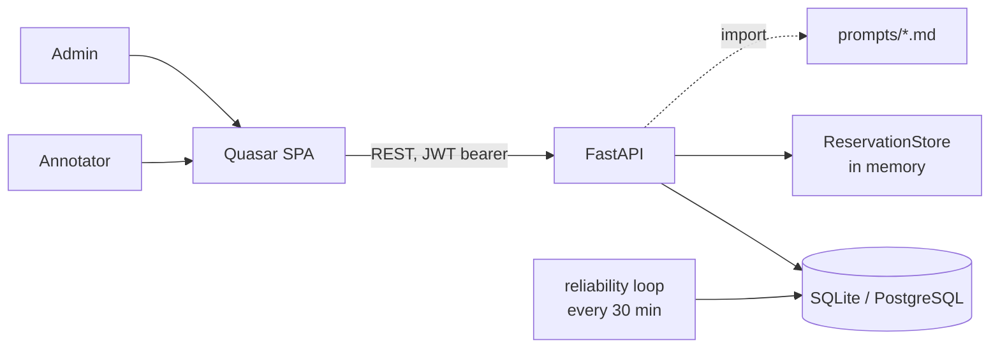
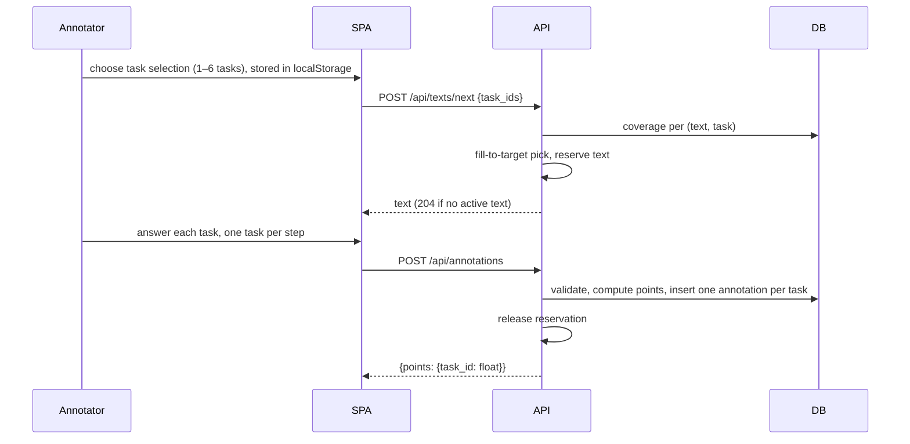

# Architecture

The app collects human annotations of texts for benchmarking AI classifiers. Terms: [glossary.md](glossary.md).

- Backend: FastAPI, async SQLAlchemy, fastapi-users (JWT). One process; reservations and the reliability loop are in memory.
- Frontend: Quasar (Vue 3, `<script setup>`), Axios through `src/services/api.ts`.
- Optional: the backend serves the built SPA from `STATIC_PATH`.

Module map: [code_map.md](code_map.md). Tables: [data_model.md](data_model.md).

## Annotation flow

Sampling, points and reliability: [sampling_and_scoring.md](sampling_and_scoring.md).

## Task flow

Prompt files → import → DB task → edited in Admin → Tasks. The DB is authoritative; re-import overwrites it. See [task_definitions.md](task_definitions.md).

## Frontend pages

| Route | Page | Content |
|---|---|---|
| `/login` | `LoginPage.vue` | Login and registration (`display_name` optional). |
| `/classify` | `ClassificationPage.vue` | Task selection dialog, one task per step, summary panel, calibration feedback panel (inactive). |
| `/leaderboard` | `LeaderboardPage.vue` | Own stats, overall leaderboard (weekly / all time), per-task leaderboards. |
| `/admin` | `AdminPage.vue` | Tabs: Tasks, Import, Texts, Coverage, Reliability. Superuser only (enforced by the API). |
