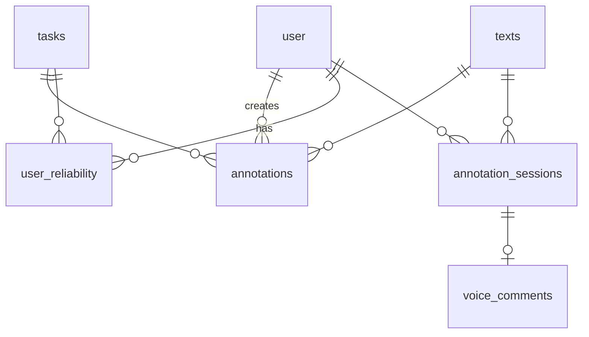

# Data Model

Source: `backend/text_classifier/db_model.py`, `backend/text_classifier/database.py`. Terms: [glossary.md](glossary.md).

## `tasks` (`Task`)

| Column | Notes |
|---|---|
| `id` | Task ID; equals the prompt file stem. |
| `name` | Display name. |
| `description_md` | Task prompt (markdown) shown to annotators. |
| `multi_choice`, `max_choices` | Single-choice tasks have `max_choices = 1`. |
| `enabled` | Disabled tasks are hidden and rejected on submit. |
| `classes` | JSON list of `{id, label_en, label_cs, description}`. |
| `target_coverage` | Used by the sampler, the scarcity multiplier and coverage stats. |
| `calib_ratio_initial`, `calib_initial_count`, `calib_ratio_ongoing` | Calibration settings. Unused while calibration is disabled. |
| `repeat_probability` | Unused since fill-to-target sampling. |

## `texts` (`TextItem`)

| Column | Notes |
|---|---|
| `id` | From JSONL `id`; uploading the same ID again upserts. |
| `text`, `language` | From JSONL; `language` is ISO 639-3. |
| `raw_json` | The full JSONL row, kept for export and benchmarking. |
| `suspended` | Suspended texts are excluded from sampling and coverage. |
| `random_order` | Random float, indexed. Not read by current code. Backfill: `backend/add_random_column.py`. |

## `annotations` (`Annotation`)

| Column | Notes |
|---|---|
| `user_id`, `text_id`, `task_id` | No unique constraint: the same user may annotate the same (text, task) more than once. |
| `selected_classes` | JSON list of **class IDs** (not labels). |
| `start_time`, `end_time` | Set by the client per task; equal to upload time for GT and LLM annotations. |
| `created_at` | Server time (UTC, naive). |
| `annotation_type` | `user` / `ground_truth` / `llm`. Only `user` annotations count for stats, leaderboards, coverage and points. |
| `weight` | Always 1.0; nothing updates it. Read by the points formula. |
| `points_earned` | Set at submit for `user` annotations; `NULL` for GT and LLM annotations. |

GT and LLM annotations are stored under the uploading admin's `user_id`. A bulk upload upserts by (admin, text, task, type).

## `annotation_sessions` (`AnnotationSession`)

One row per submitted annotation session; see [voice_comments.md](voice_comments.md).

| Column | Notes |
|---|---|
| `id` | UUID generated by the client when the text is shown. Unique: a session is submitted once. |
| `user_id`, `text_id` | Indexed. |
| `task_ids` | JSON list, in task order. |
| `annotation_ids` | JSON list of the `annotations.id` created by the submit (no FK column on `annotations`, so no `ALTER TABLE` was needed). |
| `client_started_at` | Client time when the text was shown (UTC, naive). |
| `events` | JSON list of `{type, t_ms, task_id?, class_id?}`; `t_ms` on the session clock. |
| `submitted_at` | Server time (UTC, naive). |

Submits without a `session` (older clients) create annotations only.

## `voice_comments` (`VoiceComment`)

| Column | Notes |
|---|---|
| `session_id` | FK to `annotation_sessions.id`, unique: at most one voice comment per session. |
| `user_id`, `text_id` | Copied from the session. |
| `language` | `cs` or `sk`, chosen by the annotator. |
| `file_path` | Relative to `VOICE_AUDIO_PATH`. |
| `mime_type`, `size_bytes` | Base MIME type without codec parameters. |
| `start_ms`, `end_ms` | Recording start and end on the session clock. |
| `transcription_status` | `pending` / `done` / `failed`; indexed. |
| `transcription_attempts`, `transcription_error` | Retry state of the transcription job. |
| `transcript`, `transcript_segments`, `transcription_model`, `transcribed_at` | Result; `transcript_segments` only with `whisper-1`. |

## `user` (`User`, fastapi-users)

Standard fastapi-users columns plus `display_name` (optional). The admin account is created at startup from `ADMIN` and `ADMIN_PASSWORD`.

## `user_reliability` (`UserReliability`)

One row per (user, task); unique. Holds `pairwise_agreement`, `cohens_kappa`, `krippendorffs_alpha`, `ds_sensitivity` (always `NULL`), `annotation_count` and `computed_at`. Written by `reliability.run_reliability_job`; see [sampling_and_scoring.md](sampling_and_scoring.md#reliability).

## Invariants

- Annotations reference class IDs, so changing `label_cs`, `label_en`, `description` or `description_md` is safe. Renaming or removing a class ID orphans existing annotations.
- Class labels referenced in a task prompt must match `label_cs` exactly; see [task_definitions.md](task_definitions.md#labels-and-prompts).
- Deleting a task (`PATCH /api/admin/tasks/{id}` with `deleted: true`) deletes the task row only. Its annotations remain and point to a missing task.

## Schema changes

There are no migrations. On startup, `Base.metadata.create_all` creates missing tables but never alters existing ones. To add a column to an existing DB, back it up and run `ALTER TABLE` by hand, matching the `server_default` in the model. See [operations.md](operations.md).
